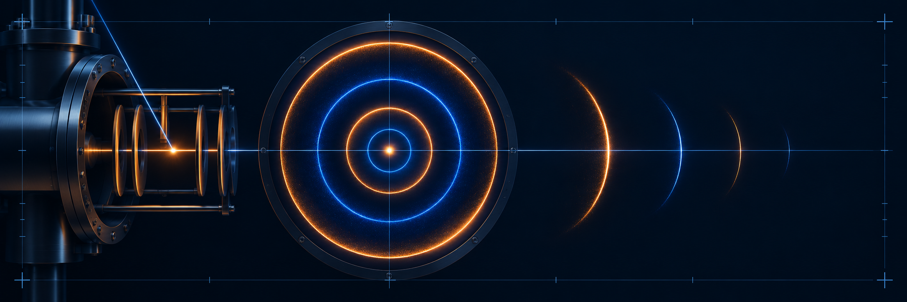

# VMI Analysis



VMI Analysis is an **Agent-native scientific workbench** for electron and ion velocity-map imaging. Run an analysis from its panel or ask the embedded Agent to prepare a supported operation. Review the inputs before approval, then follow the same queue, logs, and results in the workbench.

- **Electron** covers camera frames, dark subtraction, accumulation, spot localization, GMD binning, ring calibration, circularization, and photoelectron spectra.
- **Ion** covers Timepix3 unpacking with LUNA, time-of-flight spectra, detector positions and momentum analysis, delay-scan yields, and live monitoring.
- **Agent** can prepare registered jobs, inspect supported live views and completed runs, interpret screenshots, and propose Python analyses that can be saved as reusable workspace forms.

## Run locally

Install Python 3.12 or newer and [uv](https://docs.astral.sh/uv/). Run these commands from the checkout.

```sh
uv sync
uv run vmi-analysis
```

Open [localhost:13517](http://localhost:13517). Set `VMI_GUI_PORT` to choose another port. Leave `VMI_SHARED_CONFIG` unset for local mode. For the Windows installer, see the [installation guide](packaging/windows/README.md).

To use the local Agent, install Node.js and the Pi package pinned in the
[Agent image](packaging/agent/Dockerfile). Confirm `pi --version` works
in the shell that starts VMI Analysis. Then open **Agent → Connection**
and enter your model endpoint, model ID, API format, and key.

**Settings → Save workflow** exports form values. A Trig Calibration session separately preserves ring selections, masks, and fits. Supply your own experiment files. Use the optional `live` dependency for Timepix3 preview.

## Choose a deployment

| Mode | Use it when | Setup |
| --- | --- | --- |
| Local single user | One person runs analyses under their OS account | [Installation and first run](docs/manual.pdf) |
| Manual-only shared | A trusted Linux lab team needs separate settings and job ownership on one server without sandbox tools | [Manual-only setup and caveats](docs/shared-server.md#manual-only-shared-mode) |
| Sandboxed shared | A Linux server serves multiple accounts with isolated panel jobs and optional Agent containers | [Shared-server setup](docs/shared-server.md#set-up-the-linux-host) |

## Documentation

| If you want to | Read |
| --- | --- |
| Run an experiment workflow | [PDF user manual](docs/manual.pdf) |
| Understand the Agent and its capabilities | [Agent-native design](docs/agent-first-design.md) |
| Find where state, approvals, jobs, and results live | [Architecture](docs/architecture.md) |
| Build or extend a panel | [Panel development playbook](docs/panel-development.md) and [workbench design](docs/DESIGN.md) |
| Set up development and submit changes | [Contributing](CONTRIBUTING.md) |

## License

VMI Analysis uses the [Apache License, Version 2.0](LICENSE). Bundled CPBASEX uses the [MIT license](vendor/pbasex-matlab/LICENSE.txt). See [NOTICE](NOTICE) for attribution.
