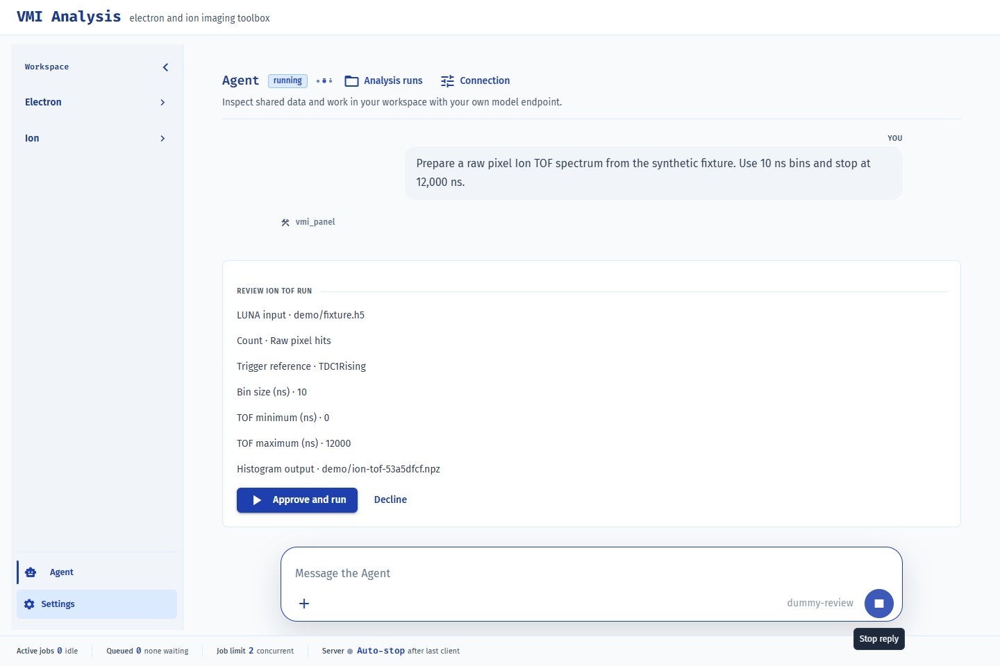
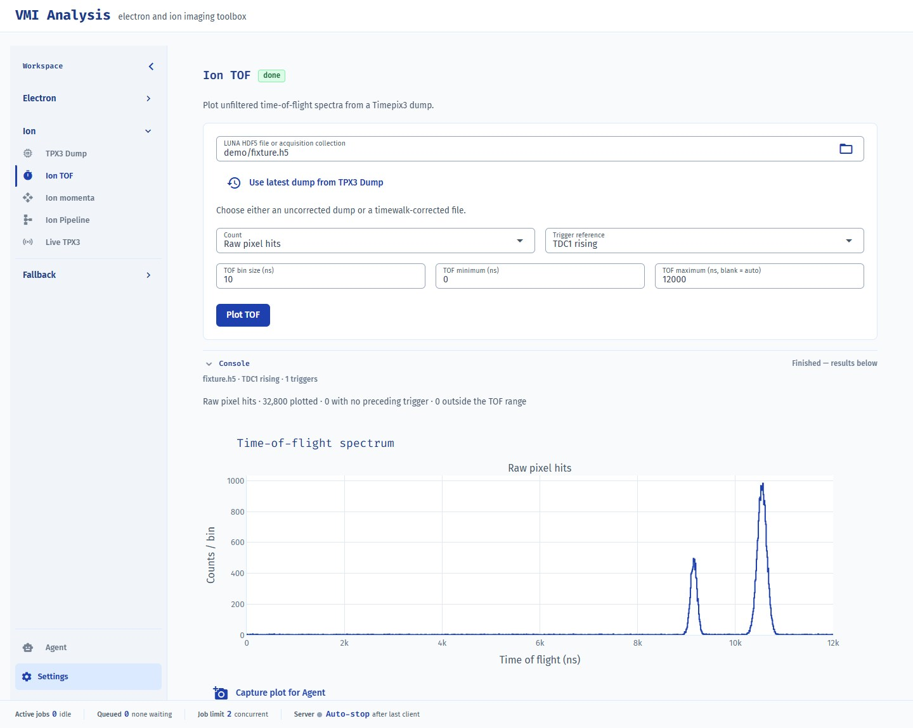

# Agent-native design

VMI Analysis is a scientific workbench for electron and ion velocity-map imaging. A user can configure a panel directly or ask the embedded Agent to prepare an analysis. Both entry points use the same scientific implementation for the operations they share. Manual operation stays available in every deployment.

## Design rules

1. **The panel owns its scientific capability.** Keep input validation, resolved settings, units, command construction, and artifact declarations with the panel. An Agent operation describes and adapts that capability. Extend the panel when the science changes.
2. **Prepare before executing.** Show the resolved inputs, settings, and outputs for a registered Agent proposal. The user can decline or approve. When an operation depends on a plot, keep its source run and selection tied to the originating view and apply edits through the panel's validation.
3. **Share the job and the result.** Registered batch operations use the common queue, file reservations, cancellation, and result views. An adopted Agent run fills the originating panel from its submitted settings. Later manual edits retain priority.
4. **Choose evidence for the question.** A screenshot supports visual interpretation. A registered measurement reads the completed run's data for exact numbers. A live inspection reads a snapshot from the originating tab. Describe the evidence and its limits.
5. **Review new analysis as code.** A user can review and run a Python script, inspect its records and artifacts, and save a declarative form for reuse in the workspace. A permanent built-in panel goes through ordinary repository review.
6. **Make authority explicit.** Account ownership, approved operations, and process isolation address different parts of the design. The Agent's shell and file tools run with the authority of its session. Standard panel jobs and reviewed Python runs have their own execution policies. The deployment guide defines the three modes and their trust assumptions.

## Agent capabilities

The table describes the registered actions in the current application. The Agent can discover their inputs through `vmi_panel describe`. A registration covers the listed action. Each panel may have additional manual controls.

| Panel | Operation ID | Agent capability |
| --- | --- | --- |
| GMD Map | `gmd_map` | Prepare the timestamp-based GMD map. |
| Movie | `movie` | Prepare a frame preview or export. |
| Dark Frame | `dark_frame` | Prepare a mean or median dark frame. |
| Accumulate | `accumulate` | Prepare image accumulation. |
| Centroiding | `centroiding` | Prepare localization and spectrum processing with the panel's settings. |
| Binning | `binning` | Prepare GMD-weighted binning. |
| Trig Calibration | `trig_calibration_fit` | Review and fit a selected ring from the panel's **Ask Agent** control. |
| Circularize | `circularize`, `circularize_checkpoint` | Correct an image, or export measured or circularized centroids with a shot roster and an integer histogram. |
| PES | `pes`, `pes_fit` | Prepare spectra and anisotropy. Measure yield, bin-average intensity, and β in a uniform-grid bin of a completed run. Review a peak fit from the panel's **Ask Agent** control. |
| TPX3 Dump | `tpx3_dump` | Prepare the LUNA dump. Apply timewalk correction manually in the panel. |
| Ion TOF | `ion_tof`, `ion_tof_gate`, `ion_tof_fit` | Prepare spectra, GMD2 gating with optional per-shot weighting, and Gaussian fits. Inspect linked completed spectra and saved fits through registered measurements. |
| Ion momenta | `ion_momenta` | Prepare the initial linked detector-position and TOF histograms. Set gates, assign species, and reconstruct in the panel. |
| Ion Pipeline | `ion_pipeline` | Prepare the delay-scan yield analysis with optional scan-wide GMD2 weighting. |
| Live TPX3 | `live_tpx3` | Inspect the running preview in the originating tab. Start and stop the receiver in the panel. |

The **TPX3 Dump → Ion TOF** workflow (`ion_dump_to_tof`) passes the exact planned output to the TOF stage and can pause for a GMD2 alignment decision. **Analysis runs** (`analysis_python`) supports reviewed scripts and saved analysis forms. The **Ion → Fallback** tools remain manual. Access by external agents through MCP or a general Agent CLI is deferred. Scientific CLI modules remain available.

## Review and inspect a run

The Agent presents an Ion TOF proposal. The user can check the input, trigger, bin width, and output before submitting.

After approval, Ion TOF shows the submitted settings and spectrum. These screenshots use synthetic data, shortened display paths, and omit the local console command.

## Related references

- [Architecture and state ownership](architecture.md)
- [Contributor playbook](panel-development.md)
- [Workbench design](DESIGN.md)
- [Deployment and isolation](shared-server.md)
- [Delivery record and remaining work](agent-first-overhaul-plan.md)
