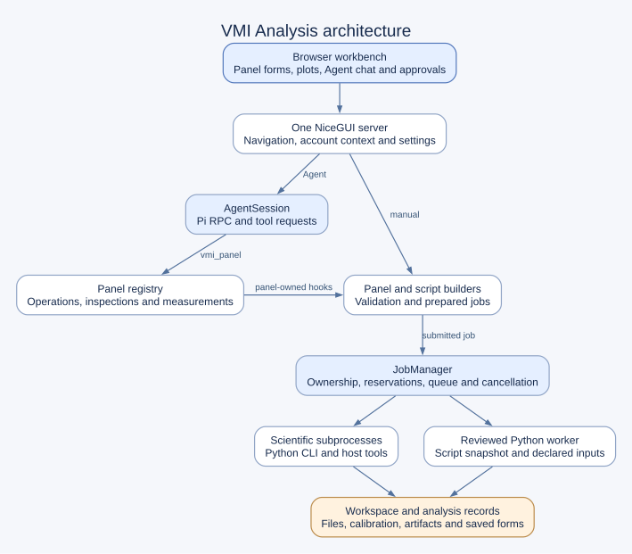
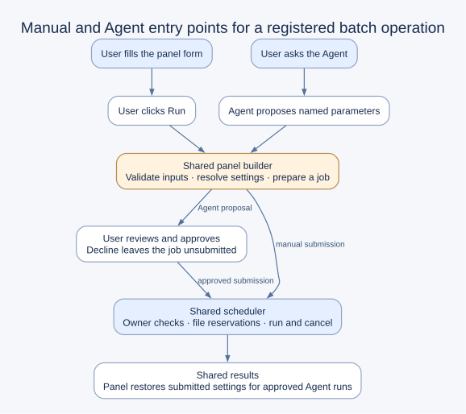

# Application architecture

VMI Analysis is one NiceGUI server with a panel registry, a shared job scheduler, and an embedded Agent. `gui/app.py` composes navigation, authentication integration, settings, panels, and shutdown. `gui/panel_operations.py` explicitly assembles the Agent registry from panel-owned declarations.

All source paths below are relative to [`src/vmi_analysis`](../src/vmi_analysis/).

| Area | Code | Responsibility |
| --- | --- | --- |
| Workbench and views | `gui/app.py`, `gui/panels/`, `gui/theme.py`, `gui/assets/` | Forms, plots, panel navigation, approvals, and rendering. |
| Panel contract | `gui/agent_panels.py`, `gui/panel_operations.py` | Operation discovery, request validation, artifact discovery, and approved-run measurements. |
| Interactive Agent | `agent_backend.py`, `gui/panels/agent.py`, `gui/assets/agent_panels.js` | Pi RPC session, tool requests, streamed messages, proposal review, and cleanup. |
| Job execution | `gui/jobs.py`, `gui/resources.py`, `gui/job_sandbox.py` | Queue, owner checks, resource reservations, process launch, cancellation, and terminal state. |
| Shared deployment | `gui/shared.py`, `gui/workspace_io.py` | Accounts, request policy, per-user settings, and protected file access. |
| Reviewed Python | `gui/analysis_runs.py`, `gui/analysis_definition.py`, `analysis_worker.py`, `analysis_container.py` | Approved script snapshots, run records, artifact handling, and saved analysis forms. |
| Scientific implementation | `centroiding/`, `circularization/`, `gmd/`, `imaging/`, and top-level ion and PES modules | Scientific algorithms and standalone command-line entry points. |

## Follow a panel request

1. A manual form invokes the panel's job builder. An Agent request uses `vmi_panel` and `PanelRegistry.prepare` to call the same builder with named parameters. The builder validates input and creates an unsubmitted `Job` with its CLI arguments, working directory, resolved form snapshot, and output references.
2. The Agent's proposal presents the resolved run for review. Its submission happens after the user approves. A `PanelView` can bind permitted edits and rebuild against the original plot or run. Trig Calibration and PES also support reviewed interactive fitting in the web process.
3. `JobManager.submit` records ownership and checks paths in shared mode. It queues the job and reserves input, output, and exclusive resources. Reads can overlap with reads. Conflicting writes wait. A workflow reserves all of its stages for the run.
4. The runner starts the scientific subprocess and collects logs, progress, and terminal status. Cancellation stops the process tree. A workflow stage can provide a `Stage.result` for the ordinary panel to open. A `Checkpoint` can release the worker while waiting for a user decision.
5. `JobView` renders the run. The panel reads outputs from the job snapshot so later edits to the form cannot redirect results. `attach_builder` and `adopt_agent_form` restore Agent-approved settings when the view attaches and preserve subsequent manual edits.

## Agent requests and evidence

The browser Agent panel talks to the Pi RPC process through `AgentSession`. `vmi_panel` exposes `describe`, `propose`, `status`, `wait`, `inspect`, and `measure`. Inspection uses a `PanelInspection` tied to one browser tab. Exact measurements require a supported completed run visible to the current account. See the [capability matrix](agent-first-design.md#agent-capabilities).

The Agent's ordinary shell and file tools run inside its own session. A reviewed Python analysis takes a separate route through the queue and runs a saved script snapshot. The run record stores the script digest, input references and file metadata, parameters, runtime, logs, and outputs. A saved analysis form describes fields and result views for the approved script. The app renders those declarations with its own controls.

## State and recovery

| State | Owner | Lifetime |
| --- | --- | --- |
| Active view, plot selection, contextual Agent request | Browser tab and its server-side view | Current view session |
| Live Agent process and pending proposals | `AgentManager` / `AgentSession` | Current server process |
| Agent projects, saved chats, Pi context | `AgentHistory` and Pi | Account-local disk |
| Queue, job ownership, status, reservations, checkpoints | `JobManager` | Current server process |
| Saved form settings | NiceGUI storage in local mode, account `settings.json` in shared mode | Disk |
| Scientific output, calibration, workflow export, approved Python record | Workspace and account analysis storage | Disk |
| Model API key | Account connection in memory and active child environment | Until provider disconnect or server shutdown |

A reconnect can reattach to live jobs or an Agent session in the same process.
Open a saved chat in the Agent sidebar and send a message to resume it. VMI
loads the displayed transcript and starts Pi with the chat's saved context.
Projects associate chats with working directories inside the workspace. The
account's provider connection follows the user across chats. After a server
restart, connect the provider again or start the GUI from the desktop client.
A resumed chat uses the current account's mounts and requests fresh approval
for any new panel proposal.

Saved results and records also reopen from disk. A portable workflow restores
form values. Save a Trig Calibration session separately to preserve rings,
masks, and fits.

`vmi_analysis.paths` resolves the workspace. A checkout defaults to the repository root and an installed copy uses its startup directory. `VMI_WORKSPACE_DIR` overrides the default. Local generated previews live under `.cache/vmi-analysis/` by default. In shared mode the account supplies the workspace and cache roots. `centroiding/options.py` owns its option defaults and CLI serialization. `gui/settings.py` owns GUI persistence and read-only migration from older settings.

## Execution and trust

| Mode | Standard panel jobs | Agent session | Reviewed Python runs |
| --- | --- | --- | --- |
| Local single user | Host process under the local OS user | Local Pi process by default | Host Python with the local user's permissions |
| Manual-only shared | Host process under the shared Linux service account | Disabled | Disabled |
| Sandboxed shared | Bubblewrap per subprocess, including workflow stages | Docker or Podman per active account session | A fresh Docker or Podman worker per run |

A shared server authenticates HTTP and Socket.IO requests, scopes the queue to the account, and binds to loopback. Shared panel jobs in Bubblewrap see the account's writable workspace, read-only shared datasets and analysis records, and the required runtime files. The Agent container has a writable workspace, a writable history mount for its current chat, and read-only input mounts. The reviewed Python container has read-only inputs and a writable run-output folder, with networking disabled. Browser file downloads use protected file handles. See the [deployment guide](shared-server.md#security-boundary).

Manual-only shared mode keeps application-level path checks and ownership. All panel jobs inherit the service account's permissions, so cross-account reads and writes remain possible. Linux permissions still govern access to host files and shared datasets. The [manual-only setup](shared-server.md#manual-only-shared-mode) explains the required trust and service-account setup.

## Development

Use the [panel playbook](panel-development.md) to choose a job, inspection, or interactive view contract. Follow the [GUI design guide](DESIGN.md) for panel composition and the [contributor checks](../CONTRIBUTING.md#local-tests) before review.
