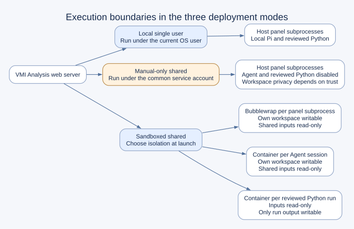

# Run a shared VMI Analysis server

One server on a Linux host serves Windows and Linux clients through SSH.
Each person needs an authorized SSH account or key and a VMI Analysis
account. The SSH tunnel connects the browser to the server. The VMI sign-in
selects the person's workspace.

## Choose a mode



| Mode | Configuration | Host tools and trust |
| --- | --- | --- |
| Local single user | Leave `VMI_SHARED_CONFIG` unset | Panel jobs use your OS account. Local Agent use needs Pi and a model endpoint. See [local startup](../README.md#run-locally). |
| Manual-only shared | Set `VMI_SHARED_CONFIG` and use `"mode": "manual-only"` | Panel jobs use the Linux service account. Use only with trusted users and data. |
| Sandboxed shared | Set `VMI_SHARED_CONFIG` and omit `mode` or use `"sandboxed"` | Bubblewrap protects panel subprocesses. Docker or Podman is required for Agent sessions and reviewed Python runs. |

## Set up the Linux host

1. Run the app under a dedicated Linux service account. Give that account
   read access to the shared data and write access to the workspace directory.
   Keep the shared data read-only at the filesystem level as well.
   Host only datasets from trusted sources. Keep the workspace directory
   private to the service account and the host administrator.
2. Install [Bubblewrap](https://github.com/containers/bubblewrap) (`bwrap`) and
   verify that the service account can create unprivileged user namespaces.
   In the default sandboxed mode, panel jobs fail if the sandbox cannot start.
   On a host that cannot use Bubblewrap, see [Manual-only shared mode](#manual-only-shared-mode).
   Keep the Python environment, application code, and host tools outside the
   shared data and workspace roots. Put the Linux LUNA executable on the
   service account's `PATH`.

   From the checkout, run `uv sync`. Run the following command once per
   VMI account to generate a password hash:

   ```sh
   uv run python -m vmi_analysis.gui.shared
   ```

3. To enable the Agent panel, install Docker or Podman for the service account,
   preferably in rootless mode, and build the bundled image from the checkout:

   ```sh
   docker build -f packaging/agent/Dockerfile -t vmi-analysis-agent:latest .
   ```

   Use `podman build` instead when Podman is the selected runtime, then set
   `VMI_AGENT_CONTAINER_RUNTIME=podman` in the server environment. The default
   runtime and image are `docker` and `vmi-analysis-agent:latest`; set
   `VMI_AGENT_IMAGE` to use another local image name. The container needs
   outbound network access to each user's chosen model endpoint, but no inbound
   ports. Docker group membership is host-root-equivalent; use rootless Docker
   or Podman where possible.

   Build from the same checkout the app runs. The image installs VMI Analysis
   and the dependencies in its `uv.lock`. It defaults to Python 3.13. Use
   `--build-arg VMI_PYTHON_VERSION=<version>` to match the app's Python version
   if needed. Rebuild when the app or lockfile changes. Keep the runtime's
   outbound access limited to services the Agent is authorized to use.

   On Linux, the same image runs approved Python analyses and saved
   analysis panels. The job worker runs without networking or the model
   API key. It mounts the signed-in account's files, analysis records,
   and shared datasets read-only, and gives only that run a writable
   output folder. Docker workers require Linux kernel 5.12 or newer for
   recursive read-only bind mounts. Use a local container runtime on
   the server host.

4. Save a JSON file outside the shared data and workspace directories.
   Replace each sample path and password hash. Keep the file readable only by
   the service account and host administrator.

   ```json
   {
     "datasets": "/srv/vmi/datasets",
     "workspaces": "/srv/vmi/workspaces",
     "max_concurrent_jobs": 2,
     "accounts": {
       "alice": {"password_hash": "<Alice's generated hash>", "admin": true},
       "bob": {"password_hash": "<Bob's generated hash>"}
     }
   }
   ```

5. Launch the server as the service account. Keep the process under your
   service manager if it must survive an administrator's SSH logout.

   ```sh
   VMI_SHARED_CONFIG=/etc/vmi/shared.json uv run vmi-analysis
   ```

Shared mode listens on `127.0.0.1:13517` by default and stays running when
all browsers disconnect. Keep the web port closed to incoming connections.
Restrict SSH to authorized users on your LAN or private VPN. For accounts that
only need the browser, ask the SSH administrator to restrict forwarding to
this port and disable shell access. See the OpenSSH
[server configuration manual](https://man.openbsd.org/sshd_config#PermitOpen).

## Enable Live TPX3 on the acquisition computer

From the checkout, run `uv sync --extra live`. Enable the acquisition
application's ZeroMQ publisher. Set the publisher address in the server's
environment before startup. For a publisher on the same host using port 5556,
launch the shared server as follows.

```sh
export VMI_SHARED_CONFIG=/etc/vmi/shared.json
export VMI_TPX3_LIVE_ENDPOINT=tcp://127.0.0.1:5556
uv run --extra live vmi-analysis
```

Set both variables in the service configuration if a service manager starts
the app. Remote users use their existing web tunnel. In **Ion → Live TPX3**,
click **Start preview** and check that the received frame count increases.
Each active preview decodes its own copy of the frames. Before deploying,
compare the saved frame count and recording rate with and without one preview
at the highest planned acquisition rate.

## Connect from Linux or Windows

### Use your browser

- **Linux:** Keep this [OpenSSH](https://man.openbsd.org/ssh#L) command running.
  Replace `ssh-user@linux-host` with your SSH username and the host name.

  ```sh
  ssh -N -o ExitOnForwardFailure=yes -L 127.0.0.1:13517:127.0.0.1:13517 ssh-user@linux-host
  ```

- **Windows:** In MobaXterm, select **Tunneling → New SSH tunnel → Local port
  forwarding**. Set the forwarded port and remote port to `13517`, and the
  remote server to `127.0.0.1`. Set the SSH server, login and port for the
  Linux host. Start the tunnel and confirm that its local listener is on
  loopback.

Open [127.0.0.1:13517](http://127.0.0.1:13517) and sign in with your VMI
account. If the client port is busy, use another local port and change the
browser URL to match. Keep the remote port set to the server port.

### Use the optional desktop client

On Windows, the VMI Analysis Client can manage the SSH tunnel and open the
same web UI in your browser. Enter your SSH connection details, then choose
**Connect**. [Build and run the client](https://github.com/jakiesumrain/vmi-analysis-client#run-on-windows)

To sign in automatically, enter your VMI username and password under
**VMI account and Agent** and choose **Save profile**. Add model settings and
an API key to start or reopen the Agent when you connect. The client uses the
OS keychain for the password and key. The server uses the key for the Agent
session. In manual-only mode, the client signs you in and opens the Workbench.

## Use your workspace

Choose **Shared datasets** in the file picker to read experiment data. Save
calibrations, workflows and output files under **My workspace**. The server
keeps your form values across browser and server restarts. Closing the browser
or tunnel leaves your jobs running. Sign back in to see jobs from the current
server process. After a server restart, open your saved results from disk.

To save an output on your computer, open **Settings**, choose **Download
workspace file**, and select the file from **My workspace**.

The server queues work when it reaches the concurrency limit. Only VMI
administrators can change the running server's limit or stop it from Settings.
Set the startup limit in the JSON file. Restart the server to add or remove
accounts or change a password hash.

## Manual-only shared mode

On a Linux host without Bubblewrap, Docker, or Podman, add
`"mode": "manual-only"` at the top level of your shared-server JSON and restart
the server. Keep the existing `datasets`, `workspaces`, and `accounts` entries.
This mode uses the host's uv environment and any tools required by the
panels you run, such as LUNA. Users still sign in on the same port and get
separate form settings, job controls, output folders, and workspace downloads.
The server disables the Agent, its attachment uploads, and its custom Python
analyses and saved panels.

**Use this mode only for a team that trusts its members and its input files.**
All panel jobs inherit the filesystem permissions of the same Linux service
account. The app checks workspace and dataset paths at
submission and limits what the browser can browse or download. During a job,
the OS permissions of that service account determine which files it can open.
A path change after validation can expose another account's files to a job.
Jobs may also be able to overwrite another account's outputs. Treat all
workspace files as accessible to the team and use sandboxed mode for data that
requires confidentiality or protection from another user.

Use a dedicated, unprivileged service account. Remove its write permission on
the shared datasets at the OS or mount level. Keep sensitive host files
inaccessible to that account, and limit its writable application storage to
the workspace directory. Keep the configuration, app, and tools outside the
workspaces. Keep unrelated credentials out of the service environment. Use a
service account without sudo or membership in a privileged container-runtime
group. Admit only trusted users and trusted input data. Restrict direct
workspace access to the service account and host administrators.

To restore sandboxed mode, remove `mode` or set it to `"sandboxed"`, install
the required tools, and restart. Switching modes preserves existing workspace
files and form settings.

## Use the Agent panel

In sandboxed mode, open **Agent** in the sidebar. Under **Settings → Agent
connection**, enter the model endpoint's base URL, model ID, API format, and
API key, then choose **Connect provider**. The provider connection stays in
memory for the account. Each Agent process receives its key through an
environment variable and removes its temporary configuration when it exits.
**Disconnect provider** stops the active Agent and clears the account's
connection. Server shutdown also clears it.

Each account has at most one live Agent session. It survives a browser reload
or disconnect. Choose **New project** in the sidebar to group chats by a folder
inside **My workspace**, or **New chat** to work from the workspace root. Open
a saved chat to read it. Send a message to start or resume the selected chat
with the account's provider connection. If a reply is running in another
chat, finish or stop that reply first. Reconnect the provider after a server
restart.

Chat history can contain prompts, attachments, file excerpts, and tool results.
The service stores it beside the account's workspace in `.agent-history`.
The Agent container can write to `/workspace` and the selected chat's history
mount. It reads shared data from `/datasets` and runs without Linux capabilities,
with a read-only root filesystem, a 1 GiB memory limit, and one CPU. Prompts,
file excerpts, command output, and other context may be sent to the chosen
model endpoint. Users should select an endpoint they trust with the data they
ask the agent to inspect. The endpoint and model must be compatible with the
selected API format. Connection settings
start collapsed. Assistant replies render as Markdown. In the instruction box,
**Enter** sends the instruction and **Shift+Enter** inserts a new line.

The container's `python` can import `vmi_analysis`, `h5py`, and the other
locked Python dependencies for scripts. For standard panel work, use an
operation from the [capability matrix](agent-first-design.md#agent-capabilities).
Review the resolved inputs, parameters, and output paths in the approval
card, then choose **Approve and run** or **Decline**. Approved jobs use the
regular VMI queue and the host's configured scientific tools, including LUNA.

For example, ask the Agent to prepare a dump of a specific shared folder,
then use that dump to plot raw pixel hits with a specified TOF bin width.
Each stage has its own approval. The Agent can follow the job status and
report the output paths. For a gated fit, supply the GMD2 limits and
alignment shift after checking the Ion TOF diagnostics, then supply the
fit range and whether to fit the gated or unfiltered spectrum. Both fit
modes count and normalize using the GMD2-gated frames.

To run the first two panels together, ask the Agent to dump a TPX3 input
and plot its unfiltered TOF. The approval shows both stages and the
output passed between them. After approval, the workflow console shows
each stage and offers **Stop workflow** while it is active. Reopen
**Agent** after a browser reload to follow the workflow on the running
server. The completed stages also appear in **TPX3 Dump** and **Ion TOF**.

## Security boundary

In sandboxed mode, the deployment separates application accounts for an approved lab team.
Standard panel subprocesses run in a Linux mount namespace. They can write to
the signed-in account's workspace and read shared datasets and that account's
analysis records. They cannot open another account's files. The namespace is
created when the job starts, after any wait in the queue. Approved Python
analyses use the separate container described above.

Downloads and Agent image attachments open files from the signed-in account's
authorized directories. Agent uploads create new files inside that account's
workspace. The server uses open file and directory handles for these operations
so a path change during the request cannot redirect them to another account.

Use separate OS accounts or isolated services if you need to run untrusted
datasets or give users shell access as the service account.
